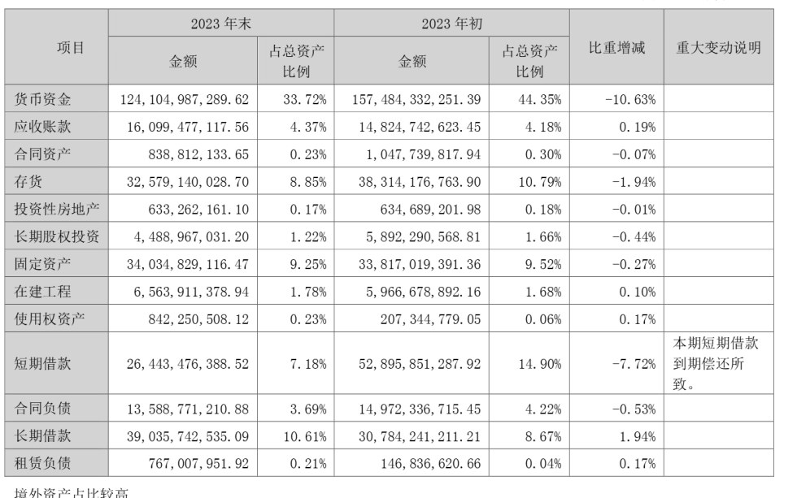
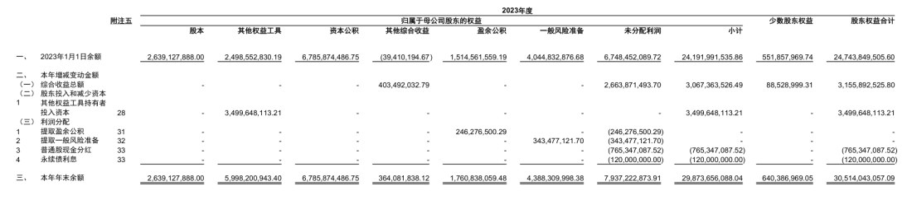

# Financial Table OCR (financial-table-ocr)

**English** | [中文](README.md)

Turns PDFs and images into **structured JSON + editable Excel**. Built for the dense tables found
in Chinese financial reports: merged cells, two-level headers, borderless tables and tables that
continue across pages are all restored into a real grid.

## Examples

### 1. Asset composition: two-level header + merged cells



15 rows × 7 columns, 100 cells. `项目` (Item) spans two rows, `2023 年末 / 2023 年初` each span
the two columns "amount / share of total assets", and the note column of `短期借款` holds
multi-line text — all restored with their actual merge relationships.

- Output: [JSON](docs/examples/000651_p029_asset_change.json) · [Excel](docs/examples/000651_p029_asset_change.xlsx)
- Runtime 10.8s (PaddleOCR-VL accounts for 8.6s)

### 2. Statement of changes in equity: 12 columns + three-level header



15 rows × 12 columns, 157 cells. The header has three levels (`归属于母公司股东的权益` splits into
6 sub-items), and the first column merges vertically across several rows — the kind of table that
is easiest to get wrong.

- Output: [JSON](docs/examples/601187_p133_equity_change.json) · [Excel](docs/examples/601187_p133_equity_change.xlsx)
- Runtime 9.9s (PaddleOCR-VL accounts for 7.8s)

Both examples are raw output of the default backend `paddleocr_vl`, with no manual corrections.

## Quick start

```bash
cd financial-table-ocr
python fetch_models.py pull   # first run: fetch weights into models/ (~2.0G, see "Model download")
bash start.sh                 # start the model service (vLLM) + web UI, wait until ready
# open http://127.0.0.1:8010
```

`start.sh` runs a preflight (Python / weights / GPU memory / ports) → starts the model service and
waits for `/v1/models` → starts the web UI and waits for `/api/health` → prints addresses, pids,
free RAM and VRAM, whether the model is online.

```bash
bash start.sh status          # what is running
bash start.sh stop            # stop everything
bash start.sh restart
bash start.sh logs            # follow model and web logs
bash start.sh start --no-model    # web UI only (local ONNX path)
WEB_PORT=8020 MODEL_PORT=8001 bash start.sh
```

If the model service cannot start, the web UI still comes up and says so explicitly ("fell back to
local ONNX, one notch lower accuracy").

Running a document from the CLI:

```bash
PYTHONPATH=src $PY -m pipeline --input data/pdfs/000651_2023_annual.pdf --pages 114-117
PYTHONPATH=src $PY -m pipeline --input data/images/ruled/000651_p029_asset_change.png --out work/out
# pick a backend / override the model endpoint
PYTHONPATH=src $PY -m pipeline --input xxx.pdf --backend legacy --model-url http://127.0.0.1:8000/v1
```

Output: `<out dir>/<name>.json` and `<name>.xlsx` (one sheet per PDF page).

## Layout

```
financial-table-ocr/
├── config.yaml            all parameters (backend, model, resource limits)
├── start.sh               one-shot start/stop: model service + web UI
├── serve_model.sh         start vLLM alone (VRAM precheck + restart-on-crash)
├── fetch_models.py        download / verify weights (the repo ships none)
├── models/                weights, not tracked (about 2.0G)
│   ├── ppocr/             PP-OCR ONNX: text detection / line orientation
│   ├── ocr/               PP-OCR ONNX: recognition model + dictionaries
│   ├── layout/            PP-DocLayoutV3 layout analysis (ONNX)
│   ├── table/             wired/wireless classifier, wired-table UNet (legacy only)
│   ├── lore/              wireless table structure (LORE, legacy only)
│   └── paddleocr_vl/      PaddleOCR-VL-1.5 weights (1.8G)
├── docs/                  example images and two sample outputs (examples/)
├── data/                  corpus and samples (not tracked)
└── src/
    ├── config.py          reads config.yaml
    ├── logging_setup.py   logging setup + per-stage timing (Stopwatch)
    ├── resource_guard.py  resource budget: RAM/VRAM thresholds, per-task growth cap
    ├── pdf2image.py       PDF → page images (PyMuPDF)
    ├── preprocess.py      skew correction + 180° flip
    ├── pipeline.py        whole document → regions (table / char)
    ├── export.py          write JSON / XLSX (including merged cells)
    ├── model/
    │   ├── onnx_session.py     single place to build sessions (no memory arena, capped threads)
    │   ├── ppocr.py            text detection / orientation / recognition
    │   ├── layout.py           layout: table boxes (with geometric re-check of low scores)
    │   ├── table_cls.py        wired / wireless classification
    │   ├── table_structure.py  wired table structure (UNet)
    │   ├── lore.py             wireless table structure (LORE)
    │   └── paddleocr_vl.py     calls PaddleOCR-VL (structure + text in one pass) + parsing
    └── web/                    web service (stdlib only, no framework)
        ├── server.py           HTTP + job orchestration (admission / budget / cleanup / shutdown)
        ├── upload.py           streaming multipart: written to disk while receiving
        ├── gate.py             admission control: bounded concurrency + bounded queue
        └── index.html          single-page front end (vanilla JS, no build step)
```

## Pipeline

```
PDF/image → page images (PyMuPDF) → deskew/flip → find tables (PP-DocLayoutV3)
          → table recognition (one of two backends) → OCR of non-table text → regions → JSON + XLSX
```

### Table recognition: two backends

Selected by `tablerec.backend` in `config.yaml`. **Both paths use local models for layout**; only
"how the inside of a table is read" changes:

| backend | structure (rows/cols/merges) | text | notes |
|---|---|---|---|
| `legacy` | wired UNet / wireless LORE (ONNX) | PP-OCR, cell by cell | offline, 2–3s per page, weaker structure |
| `paddleocr_vl` (default) | produced in one pass | in the same output | local vLLM, 7–12s per page, accurate structure |

Measured on 10 real annual-report pages, 653 numbers, compared against the PDF text layer:

| backend | number recall | number precision |
|---|---|---|
| `legacy` | 72.4% | 62.8% |
| `paddleocr_vl` | **97.7%** | **100%** |

The weak point of `legacy` is structure: missed row lines squeeze two rows into one band, so the
same numbers get written into several cells and precision drops. Use `paddleocr_vl` for dense
financial tables, `legacy` for sparse ones or when the service cannot run.

If a single table fails under `paddleocr_vl`, that table falls back to `legacy`
(`tablerec.fallback_legacy`); the rest of the page is unaffected.

### Accuracy safeguards (`paddleocr_vl`)

- **Grid validation**: row/column index conflicts, holes, or ≥60% empty cells → rejected.
- **Re-ask with a stricter prompt**: with `temperature=0` the same prompt reproduces the same
  mistake, so a harder prompt is used instead (`repair_attempts`).
- **Self-healing on overflow**: if the server reports a too-long context, the image is downscaled
  and resent (`shrink_attempts`).
- **Fallback**: if the re-ask still fails, only that table falls back — the page does not fail.

## Output format

A page is split into **regions** in reading order (top to bottom first, then left to right).
There are only two kinds:

| type | contents |
|---|---|
| `table` | `cells[]`, each with `row / col / rowspan / colspan / bbox / ocr`; indices are local to the region and start at 0 |
| `char` | a text block. `text` is the whole block (multi-line joined with `\n`), `lines[]` holds per-line `text / bbox` |

```jsonc
{
  "doc": "000651_p029_asset_change.png",
  "engine": "paddleocr_vl",
  "elapsed_s": 10.77,
  "timings": { "detect": 177, "preprocess": 248, "layout": 447,
               "model": 8585, "table": 8585, "ocr": 88, "export": 16, "total": 10769 },
  "pages": [
    {
      "page": 1, "width": 1688, "height": 2363,
      "regions": [
        { "type": "char", "bbox": [232, 155, 1119, 240],
          "text": "珠海格力电器股份有限公司2023年年度报告全文\n六、资产及负债状况分析",
          "lines": [ { "text": "珠海格力电器股份有限公司2023年年度报告全文",
                       "bbox": [586, 155, 1119, 199] } ] },

        { "type": "table", "bbox": [185, 417, 1550, 1263],
          "kind": "paddleocr_vl", "kind_score": 0.0,
          "n_rows": 15, "n_cols": 7,
          "cells": [ { "row": 0, "col": 0, "rowspan": 2, "colspan": 1,
                       "bbox": [185, 417, 380, 530], "ocr": "项目" } ] }
      ]
    }
  ]
}
```

`kind` is `wired` / `wireless` for the legacy backend and `paddleocr_vl` for the model backend.
`fallbacks[]` records which tables fell back to the local path because the model was unavailable.

Excel: one sheet per page, merged cells restored from `rowspan`/`colspan`, borders drawn, numbers
right-aligned, and non-table text laid out line by line across the full row width.

## Configuration

`config.yaml` is the single source of parameters:

```yaml
tablerec:
  backend: paddleocr_vl        # legacy | paddleocr_vl
  fallback_legacy: true        # fall back per table on failure
  paddleocr_vl:
    base_url: http://127.0.0.1:8000/v1
    model: "PaddleOCR-VL"
    prompt: "Table Recognition:"
    max_tokens: 8192
    max_side: 1600             # max long side of the image sent
    max_pixels: 2560000        # max pixels sent (≈1600×1600)
    total_timeout: 300         # per-table time budget (including retries and re-asks)
    retries: 2
    repair_attempts: 1
    shrink_attempts: 2

guard:                         # resource protection, see the section below
  max_upload_mb: 60
  max_pages: 60
  max_page_pixels: 40000000
  min_free_mb: 1200
  max_rss_mb: 4096
  max_inflight: 1
  max_pending: 4
  max_conns: 32
  keep_hours: 24
  max_work_mb: 4096
```

`render.dpi` (default 200) controls PDF rasterisation; the `preprocess` section controls the
deskew/flip thresholds.

## Web UI

Single page, no build step, no external CDN (the server is stdlib-only too):

- Drop a PDF or an image → choose backend, page range, DPI, whether to deskew → run;
- Three tabs, **all showing complete content**:
  - **Overview**: thumbnail per page, rows × cols / cell count per table, first 8 rows, per-stage
    timings for that page;
  - **Excel**: the xlsx parsed into a grid and rendered as-is — frozen row/column headers, merges
    restored, column widths taken from the file, numbers right-aligned, one tab per page;
  - **JSON**: full text with line numbers and syntax highlighting, copyable, line-wrap toggle;
- The status bar at the top states **what actually ran**: green when the model is reachable, red
  with a reason when tables fell back to the local path;
- Results are deep-linkable: `/?job=<job id>&tab=json` (or `excel` / `overview`), so a refresh does
  not lose them;
- The "PaddleOCR-VL parameters" panel applies to the current request only and never writes back to
  `config.yaml`.

Endpoints:

| method | path | description |
|---|---|---|
| GET | `/` | the front end |
| GET | `/api/config` | form defaults (never includes api_key) |
| GET | `/api/health` | resources and load: RAM, VRAM, RSS, queue depth, rejections, model service state |
| GET | `/api/probe?base_url=` | probe the model service |
| POST | `/api/run` | multipart upload; returns a summary + download links + `engine` (what ran / why it fell back) |
| GET | `/api/summary/<job>` | job summary (reopen results after a refresh) |
| GET | `/api/doc/<job>` | the full JSON |
| GET | `/api/sheets/<job>` | the xlsx parsed into a grid (values + merges + column widths) |
| GET | `/api/file/<job>/<name>` | download the json / xlsx |

## Resource protection

Goal: **the process is never OOM-killed**. Under overload the symptom is some requests getting
429/503, not the service disappearing.

| gate | location | behaviour |
|---|---|---|
| streaming upload | `src/web/upload.py` | written to disk in 256KB chunks; memory independent of file size; over-limit 413 |
| connection cap | `src/web/server.py` | above `max_conns` → 503 + `Retry-After` |
| admission control | `src/web/gate.py` | `max_inflight` running + `max_pending` queued; full → 429 |
| pre-run budget | `resource_guard.Budget` | free RAM below `min_free_mb` → refuse to start (503) |
| in-task budget | between pages | task growth above `max_rss_mb` → abort that job (503) |
| per-page pixel cap | `pipeline` | oversized pages are downscaled first |

Supporting measures: every model session goes through `src/model/onnx_session.py` (onnxruntime
memory arena disabled — per-page peak drops from 4.15GB to 1.51GB); only one Pipeline is cached;
job artefacts are cleaned up according to `keep_hours` / `max_work_mb`. Measured with 30
concurrent uploads: 5 succeeded, 25 rate-limited, **0 server errors**, same pid, no memory growth.

At runtime `work/` holds intermediate files and logs (`work/run` pids, `work/logs` logs,
`work/web/<job>` artefacts); the whole directory can be deleted at any time.

## Model download

The repository ships no weights (`.gitignore` excludes `models/` and all `.onnx/.safetensors/.pt`
files); everything is fetched from ModelScope on demand:

```bash
python fetch_models.py list                  # show the manifest and what is missing
python fetch_models.py pull                  # download what is missing (skips files already matching)
python fetch_models.py pull --only vl,layout # only some groups: vl / text / layout / table / lore
python fetch_models.py verify                # verify size and sha256
```

The script is stdlib-only and runs on Windows and WSL. If WSL has no outbound network, run it on the
Windows side — files land in `models/` either way. Downloads go through a `.part` file with size and
sha256 checks, so re-running after an interruption only fills in what is missing.

| directory | files | size | source (ModelScope repo → file) |
|---|---|---|---|
| `paddleocr_vl/` | 18 files (including `model.safetensors`, 1.79G) | 1.83G | `PaddlePaddle/PaddleOCR-VL-1.5` |
| `ppocr/` | `PP-OCRv6_det_small.onnx`<br>`ch_PP-LCNet_x0_25_textline_ori_cls_mobile.onnx` | 10.4M | `greatv/oar-ocr` → `pp-ocrv6_small_det.onnx`, `pp-lcnet_x0_25_textline_ori.onnx` |
| `ocr/` | `PP-OCRv6_rec_small.onnx`, `ppocrv6_dict.txt`, `ppocr_keys_v1.txt` | 20.3M | `greatv/oar-ocr` → same file names |
| `layout/` | `pp_doc_layoutv3.onnx` | 124.5M | `PaddlePaddle/PP-DocLayoutV3_onnx` → `inference.onnx` (renamed after download) |
| `table/` | `unet.onnx`, `table_cls.onnx` | 14.4M | `RapidAI/RapidTable` → `unet.onnx`, `table_cls/paddle_cls.onnx` |
| `lore/` | `pytorch_model.pt`, `configuration.json` | 86.3M | `damo/cv_resnet-transformer_table-structure-recognition_lore` |

- The first four rows are what the default backend `paddleocr_vl` needs; `table/` and `lore/` are
  only loaded when `backend: legacy`.
- These ONNX files are upstream conversions of the official PaddlePaddle weights. For `ppocr/`,
  `ocr/` and `layout/`, the copies on the development machine are a different export of the same
  model (identical input/output signatures, pixel-for-pixel identical results on the same page), so
  `fetch_models.py` accepts either of two known sizes for them; every other file is checked by
  sha256.
- `lore/det.onnx` and `lore/proc.onnx` are exported by this project from `pytorch_model.pt` (inputs
  renamed to `img` / `feat`). The upstream files of the same name have different input signatures
  and cannot be dropped in, so they are not in the download list. The default backend does not need
  them; only the `legacy` backend hits them on borderless tables, and it reports a clear error if
  they are missing.

## Serving the model

1. **Weights**: `python fetch_models.py pull --only vl` (see "Model download" above). vLLM reads
   `models/paddleocr_vl/`, which must contain `config.json`, `model.safetensors`, `tokenizer*`,
   `preprocessor_config.json`, `chat_template.jinja` and the remote-code `*.py` files.

2. **Dependencies**: vLLM 0.19 needs `openai>=1.x` while the env has 0.28. Install it in isolation,
   leaving the conda env untouched:

   ```bash
   # fetch the wheel on the Windows side (any directory, e.g. wheels/)
   python -m pip download "openai<2" --no-deps -d wheels

   # install offline into an isolated directory on the WSL side
   pip install --no-index --no-deps --target ~/vllm_extra wheels/openai-1.109.1-py3-none-any.whl
   ```

   No need to repeat if already installed (`ls ~/vllm_extra/openai` should list files).

3. **Start**: `bash start.sh` (or `bash serve_model.sh` alone).

Key parameters of `serve_model.sh` (all overridable via environment variables):

| variable | default | description |
|---|---|---|
| `PY` | auto-detects `~/miniconda3/envs/llm/bin/python`, else `python3` | the environment with vLLM; can also be set with `PY=...` |
| `MODEL` / `MODEL_NAME` | `models/paddleocr_vl` / `PaddleOCR-VL` | weight path and served model name |
| `PORT` | `8000` | OpenAI-compatible port |
| `GPU_MEM` | `0.60` | fraction of VRAM (about 9.8G, leaving headroom for the system) |
| `MAX_LEN` | `16384` | context length, caps the KV cache |
| `NEED_MB` | `8192` | free-VRAM threshold at startup; exits if not met |
| `EAGER` | `1` | skip `torch.compile` (compilation takes 5–10 minutes under WSL) |
| `RESTART_MAX` | `5` | maximum automatic restarts after a crash |

## Environment

WSL `Ubuntu-2204` + conda env `llm` (Python 3.10): torch 2.10+cu128 / transformers 4.57 /
onnxruntime / OpenCV / PyMuPDF / openpyxl. GPU: RTX 4070 Ti SUPER 16G, 16G RAM.

## Known limitations

- Text outside tables is returned as whole blocks or lines with coordinates, without layout
  classification (headings, body text and page headers are not distinguished).
- Cell `bbox` values from `paddleocr_vl` are estimated by evenly dividing the table box by
  rows/columns; they are good for ordering and column widths. For pixel-accurate boxes use the
  `legacy` backend.
- At most `guard.max_pages` pages per request; split longer PDFs by page range.
- Row-line completion for dense tables (inferring row boundaries from text-line y positions) is not
  implemented, so the `legacy` backend may still merge cells.
- Borderless tables in the `legacy` backend depend on the project-exported `lore/det.onnx` and
  `lore/proc.onnx` (not in the download list). If they are missing, use the default backend
  `paddleocr_vl`.
