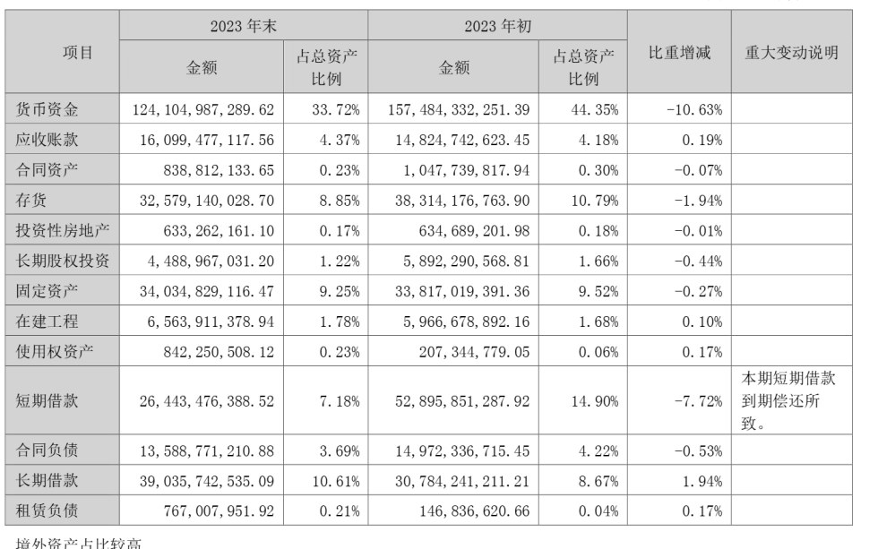
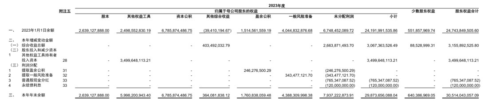

# 财报表格识别（financial-table-ocr）

PDF / 图片 → **结构化的 JSON + 可编辑的 Excel**。面向中文财报的密集表格：
合并单元格、两级表头、无线表、跨页续表都能还原成真正的网格。

## 案例

### 1. 资产构成表：两级表头 + 合并单元格



15 行 × 7 列、100 格。`项目` 纵跨两行，`2023 年末 / 2023 年初` 各横跨「金额 / 占总资产比例」
两列，`短期借款` 的说明栏是多行文本——这些都按真实合并关系还原。

- 产物：[JSON](docs/examples/000651_p029_asset_change.json) · [Excel](docs/examples/000651_p029_asset_change.xlsx)
- 耗时 10.8s（其中 PaddleOCR-VL 8.6s）

### 2. 所有者权益变动表：12 列 + 三级表头



15 行 × 12 列、157 格。表头三层（`归属于母公司股东的权益` 下再分 6 个子项），
首列科目名与多列纵向合并同时存在，是财报里最容易识别错的一类表。

- 产物：[JSON](docs/examples/601187_p133_equity_change.json) · [Excel](docs/examples/601187_p133_equity_change.xlsx)
- 耗时 9.9s（其中 PaddleOCR-VL 7.8s）

两份示例都是由本项目的默认后端 `paddleocr_vl` 直接跑出来的原始产物，未做任何手工修正。

## 快速开始

```bash
cd financial-table-ocr
python fetch_models.py pull   # 首次：拉权重到 models/（约 2.0G，见「模型下载」）
bash start.sh                 # 起模型服务（vLLM）+ 网页前端，等到就绪
# 浏览器打开 http://127.0.0.1:8010
```

`start.sh` 依次做：环境体检（Python / 权重 / 显存 / 端口）→ 起模型并等 `/v1/models`
→ 起前端并等 `/api/health` → 打印地址、pid、内存与显存、模型是否在线。

```bash
bash start.sh status          # 谁在跑
bash start.sh stop            # 全停
bash start.sh restart
bash start.sh logs            # 跟踪模型与前端日志
bash start.sh start --no-model    # 只起前端（走本地 ONNX 链路）
WEB_PORT=8020 MODEL_PORT=8001 bash start.sh
```

模型起不来时前端照样启动，并明确提示"已退回本地 ONNX（准确率低一档）"。

命令行直接跑一份文档：

```bash
PYTHONPATH=src $PY -m pipeline --input data/pdfs/000651_2023_annual.pdf --pages 114-117
PYTHONPATH=src $PY -m pipeline --input data/images/ruled/000651_p029_asset_change.png --out work/out
# 指定后端 / 覆盖模型地址
PYTHONPATH=src $PY -m pipeline --input xxx.pdf --backend legacy --model-url http://127.0.0.1:8000/v1
```

产物：`<输出目录>/<文件名>.json` 与 `<文件名>.xlsx`（PDF 每页一个 sheet）。

## 结构

```
financial-table-ocr/
├── config.yaml            全部参数（后端、模型、资源限额）
├── start.sh               一键启停：模型服务 + 前端
├── serve_model.sh         单独起 vLLM（显存预检 + 崩溃守护重启）
├── fetch_models.py        下载 / 校验权重（仓库不含权重）
├── models/                权重目录，不入库（约 2.0G）
│   ├── ppocr/             PP-OCR ONNX：文字检测 / 方向分类
│   ├── ocr/               PP-OCR ONNX：识别模型 + 字典
│   ├── layout/            版面分析 PP-DocLayoutV3（ONNX）
│   ├── table/             有线 / 无线分类、有线表 UNet（legacy 用）
│   ├── lore/              无线表结构（读光 LORE，legacy 用）
│   └── paddleocr_vl/      PaddleOCR-VL-1.5 权重（1.8G）
├── docs/                  案例图与两份产物示例（examples/）
├── data/                  语料与样本（不入库）
└── src/
    ├── config.py          读 config.yaml
    ├── logging_setup.py   logging 配置 + 分阶段计时（Stopwatch）
    ├── resource_guard.py  资源预算：内存/显存门槛、任务内增量上限
    ├── pdf2image.py       PDF → 页图（PyMuPDF）
    ├── preprocess.py      倾斜矫正 + 180° 翻转
    ├── pipeline.py        整份文档 → 分区结果（table / char）
    ├── export.py          写 JSON / XLSX（含合并单元格）
    ├── model/
    │   ├── onnx_session.py     统一建会话（关内存池、限线程数）
    │   ├── ppocr.py            文字检测 / 方向判别 / 识别
    │   ├── layout.py           版面：表格框（含低分框几何复核）
    │   ├── table_cls.py        有线 / 无线分类
    │   ├── table_structure.py  有线表结构（UNet）
    │   ├── lore.py             无线表结构（读光）
    │   └── paddleocr_vl.py     调 PaddleOCR-VL（结构+文字一次出）+ 输出解析
    └── web/                    网页服务（标准库，无框架）
        ├── server.py           HTTP + 任务编排（准入 / 预算 / 清理 / 优雅退出）
        ├── upload.py           流式 multipart：边收边落盘
        ├── gate.py             准入控制：有界并发 + 有界排队
        └── index.html          单页前端（原生 JS，无构建）
```

## 处理流程

```
PDF/图片 → 页图(PyMuPDF) → 倾斜/翻转矫正 → 版面找表(PP-DocLayoutV3)
        → 表格识别（两种后端任选）→ 表格外正文 OCR → 分区输出 → JSON + XLSX
```

### 表格识别：两条后端

`config.yaml` 的 `tablerec.backend` 选。**版面找表两条路都用本地模型**，只换"表内怎么读"：

| backend | 结构（行列/合并） | 文字 | 特点 |
|---|---|---|---|
| `legacy` | 有线 UNet / 无线读光 ONNX | PP-OCR 逐格识别 | 离线、2~3s/页，结构偏弱 |
| `paddleocr_vl`（默认） | PaddleOCR-VL 一次出 | 同一次输出里带 | 本机 vLLM、7~12s/页，结构准 |

实测（10 张真实年报页、653 个数字，与 PDF 文字层的数字比对）：

| 后端 | 数字召回 | 数字精确 |
|---|---|---|
| `legacy` | 72.4% | 62.8% |
| `paddleocr_vl` | **97.7%** | **100%** |

legacy 的短板是结构：漏检的行线会把两行挤进同一行带，同一批数字被重复写进多个格子，
所以精确率偏低。密集财报表建议 `paddleocr_vl`，稀疏表或起不了服务时用 `legacy`。

`paddleocr_vl` 单张表失败会自动退回 legacy（`tablerec.fallback_legacy`），整页不受影响。

### 准确性保障（`paddleocr_vl`）

- **网格校验**：行列号冲突、有空洞、或 ≥60% 格子为空 → 判不合格。
- **换提示词重问**：`temperature=0` 时同词只会复现同一个错，所以换更硬的提示词（`repair_attempts`）。
- **超长自愈**：服务端报上下文超长时自动缩图重发（`shrink_attempts`）。
- **兜底**：重问仍不合格只退这一张表，不失败整页。

## 输出格式

一页拆成若干**分区**，按阅读顺序（先上下、再左右）排。只有两种：

| type | 内容 |
|---|---|
| `table` | `cells[]` 每格带 `row / col / rowspan / colspan / bbox / ocr`，行列号是该分区自己的，从 0 开始 |
| `char` | 文字块。`text` 是整块文本（多行用 `\n`），`lines[]` 是逐行 `text / bbox` |

```jsonc
{
  "doc": "000651_p029_asset_change.png",
  "engine": "paddleocr_vl",
  "elapsed_s": 10.77,
  "timings": { "detect": 177, "preprocess": 248, "layout": 447,
               "model": 8585, "table": 8585, "ocr": 88, "export": 16, "total": 10769 },
  "pages": [
    {
      "page": 1, "width": 1688, "height": 2363,
      "regions": [
        { "type": "char", "bbox": [232, 155, 1119, 240],
          "text": "珠海格力电器股份有限公司2023年年度报告全文\n六、资产及负债状况分析",
          "lines": [ { "text": "珠海格力电器股份有限公司2023年年度报告全文",
                       "bbox": [586, 155, 1119, 199] } ] },

        { "type": "table", "bbox": [185, 417, 1550, 1263],
          "kind": "paddleocr_vl", "kind_score": 0.0,
          "n_rows": 15, "n_cols": 7,
          "cells": [ { "row": 0, "col": 0, "rowspan": 2, "colspan": 1,
                       "bbox": [185, 417, 380, 530], "ocr": "项目" } ] }
      ]
    }
  ]
}
```

`kind` 取值：`wired` / `wireless`（legacy 后端）、`paddleocr_vl`（模型后端）。
`fallbacks[]` 记录哪些表因模型不可用退回了本地链路。

Excel：一页一个 sheet，合并单元格按 `rowspan/colspan` 还原、带框线、数字右对齐，
表格外正文按行铺满整行。

## 配置

`config.yaml` 是唯一参数来源：

```yaml
tablerec:
  backend: paddleocr_vl        # legacy | paddleocr_vl
  fallback_legacy: true        # 单表失败退回本地链路
  paddleocr_vl:
    base_url: http://127.0.0.1:8000/v1
    model: "PaddleOCR-VL"
    prompt: "Table Recognition:"
    max_tokens: 8192
    max_side: 1600             # 送图长边上限
    max_pixels: 2560000        # 送图像素上限（≈1600×1600）
    total_timeout: 300         # 单表总时间预算（含重试与重问）
    retries: 2
    repair_attempts: 1
    shrink_attempts: 2

guard:                         # 资源保护，见下节
  max_upload_mb: 60
  max_pages: 60
  max_page_pixels: 40000000
  min_free_mb: 1200
  max_rss_mb: 4096
  max_inflight: 1
  max_pending: 4
  max_conns: 32
  keep_hours: 24
  max_work_mb: 4096
```

`render.dpi`（默认 200）控制 PDF 渲染分辨率；`preprocess` 段控制倾斜/翻转矫正阈值。

## 网页界面

单页、无构建、无外部 CDN（服务端也是标准库写的）：

- 拖入 PDF 或图片 → 选后端、页范围、DPI、是否矫正 → 开始识别；
- 三个标签，**都是完整内容**：
  - **概览**：每页缩略图、每张表的行×列/格数、前 8 行速览、该页各阶段耗时；
  - **Excel**：xlsx 解析成网格后原样铺开——行列号与列标冻结、合并单元格还原、
    列宽按 xlsx 记录、数字右对齐、多页时为 sheet 标签；
  - **JSON**：全文 + 行号 + 语法高亮，可复制、可切自动换行；
- 顶部状态条直接说明**这次谁在跑**：模型可达为绿，有表退回本地则亮红并附原因；
- 结果可深链打开：`/?job=<任务ID>&tab=json`（或 `excel` / `overview`），刷新不丢；
- 「PaddleOCR-VL 参数」面板只作用于本次请求，不写回 `config.yaml`。

接口：

| 方法 | 路径 | 说明 |
|---|---|---|
| GET | `/` | 前端页面 |
| GET | `/api/config` | 表单默认值（不含 api_key） |
| GET | `/api/health` | 资源与负载：内存、显存、RSS、排队深度、已拒次数、模型服务状态 |
| GET | `/api/probe?base_url=` | 探活模型服务 |
| POST | `/api/run` | multipart 上传，返回摘要 + 下载链接 + `engine`（实际引擎/降级原因） |
| GET | `/api/summary/<job>` | 任务摘要（刷新后重开结果） |
| GET | `/api/doc/<job>` | 完整 JSON |
| GET | `/api/sheets/<job>` | xlsx 解析成网格（行值 + 合并区 + 列宽） |
| GET | `/api/file/<job>/<name>` | 下载 json / xlsx |

## 资源保护

目标：**进程永不被 OOM 杀掉**。过载时的表现是部分请求拿到 429/503，而不是服务消失。

| 闸门 | 位置 | 行为 |
|---|---|---|
| 上传流式落盘 | `src/web/upload.py` | 256KB 分块写文件，内存与文件大小无关；超限 413 |
| 连接数上限 | `src/web/server.py` | 超过 `max_conns` 直接 503 + `Retry-After` |
| 准入控制 | `src/web/gate.py` | 在跑 `max_inflight` 单、排队 `max_pending` 单，满了 429 |
| 开工前预算 | `resource_guard.Budget` | 可用内存 < `min_free_mb` 不开工（503） |
| 任务内预算 | 每页之间 | 本任务内存增量 > `max_rss_mb` 中止这一单（503） |
| 单页像素上限 | `pipeline` | 超大页先等比缩小 |

配套：模型会话统一走 `src/model/onnx_session.py`（关 onnxruntime 内存池，单页峰值
4.15GB → 1.51GB）；Pipeline 只缓存一份；产物按 `keep_hours` / `max_work_mb` 自动清理。
实测 30 并发：成功 5、限流 25、**0 个 500**，进程 pid 不变、内存不累积。

运行期会在 `work/` 下生成中间产物与日志（`work/run` pid、`work/logs` 日志、
`work/web/<job>` 任务产物），整目录可随时删除。

## 模型下载

仓库不含任何权重（`.gitignore` 排除了 `models/` 与所有 `.onnx/.safetensors/.pt` 等文件），
全部从 ModelScope 现取：

```bash
python fetch_models.py list                  # 看清单，标出还缺哪些
python fetch_models.py pull                  # 下载缺失项（大小已对上就跳过）
python fetch_models.py pull --only vl,layout # 只下某几组：vl / text / layout / table / lore
python fetch_models.py verify                # 校验大小与 sha256
```

脚本只用标准库，Windows 与 WSL 都能跑；WSL 出网受限时在 Windows 侧执行，产物直接落
`models/`。下载走 `.part` 临时文件 + 大小与 sha256 校验，断了重跑会接着补缺的。

| 目录 | 文件 | 大小 | 来源（ModelScope 仓库 → 文件） |
|---|---|---|---|
| `paddleocr_vl/` | 18 个文件（含 `model.safetensors` 1.79G） | 1.83G | `PaddlePaddle/PaddleOCR-VL-1.5` |
| `ppocr/` | `PP-OCRv6_det_small.onnx`<br>`ch_PP-LCNet_x0_25_textline_ori_cls_mobile.onnx` | 10.4M | `greatv/oar-ocr` → `pp-ocrv6_small_det.onnx`、`pp-lcnet_x0_25_textline_ori.onnx` |
| `ocr/` | `PP-OCRv6_rec_small.onnx`、`ppocrv6_dict.txt`、`ppocr_keys_v1.txt` | 20.3M | `greatv/oar-ocr` → 同名文件 |
| `layout/` | `pp_doc_layoutv3.onnx` | 124.5M | `PaddlePaddle/PP-DocLayoutV3_onnx` → `inference.onnx`（下载后改名） |
| `table/` | `unet.onnx`、`table_cls.onnx` | 14.4M | `RapidAI/RapidTable` → `unet.onnx`、`table_cls/paddle_cls.onnx` |
| `lore/` | `pytorch_model.pt`、`configuration.json` | 86.3M | `damo/cv_resnet-transformer_table-structure-recognition_lore` |

- 前四行是默认后端 `paddleocr_vl` 需要的；`table/` 与 `lore/` 只在 `backend: legacy` 时加载。
- 这些 ONNX 由上游从飞桨官方权重转换而来：`ppocr/`、`ocr/`、`layout/` 三个目录里开发机上
  的副本是同模型的另一次导出（输入输出签名一致，同一页逐格结果完全相同），`fetch_models.py`
  对它们放宽为「大小落在两个已知值之一即可」，其余文件按 sha256 严格校验。
- `lore/det.onnx` 与 `lore/proc.onnx` 是本项目从 `pytorch_model.pt` 导出的（输入改名为
  `img` / `feat`），上游同名文件输入签名不同、不能直接顶替，所以不在下载清单里。默认后端
  用不到它们；只有 `legacy` 后端遇到无线表格时才需要，缺了会明确报错。

## 部署模型服务

1. **权重**：`python fetch_models.py pull --only vl`（见上面「模型下载」）。
   vLLM 从 `models/paddleocr_vl/` 读，含 `config.json`、`model.safetensors`、`tokenizer*`、
   `preprocessor_config.json`、`chat_template.jinja` 与几个 `*.py` 远程代码。

2. **依赖**：vLLM 0.19 需要 `openai>=1.x`，环境里是 0.28。隔离装，不动 conda env：

   ```bash
   # Windows 侧下轮子（放任意目录，例如 wheels/）
   python -m pip download "openai<2" --no-deps -d wheels

   # WSL 侧离线装到隔离目录，不碰 conda env
   pip install --no-index --no-deps --target ~/vllm_extra wheels/openai-1.109.1-py3-none-any.whl
   ```

   已经装过就不用重复（`ls ~/vllm_extra/openai` 能列出来即可）。

3. **启动**：`bash start.sh`（或单独 `bash serve_model.sh`）。

`serve_model.sh` 的关键参数（均可用环境变量覆盖）：

| 变量 | 默认 | 说明 |
|---|---|---|
| `PY` | 自动探测 `~/miniconda3/envs/llm/bin/python`，否则 `python3` | 装了 vLLM 的环境；也可 `PY=...` 显式指定 |
| `MODEL` / `MODEL_NAME` | `models/paddleocr_vl` / `PaddleOCR-VL` | 权重路径与服务名 |
| `PORT` | `8000` | OpenAI 兼容端口 |
| `GPU_MEM` | `0.60` | 显存占比（约 9.8G，余量留给系统） |
| `MAX_LEN` | `16384` | 上下文长度，限制 KV 上限 |
| `NEED_MB` | `8192` | 启动前显存门槛，不够直接退出 |
| `EAGER` | `1` | 跳过 `torch.compile`（WSL 上编译要 5~10 分钟） |
| `RESTART_MAX` | `5` | 崩溃自动重启次数上限 |

## 环境

WSL `Ubuntu-2204` + conda env `llm`（Python 3.10）：torch 2.10+cu128 / transformers 4.57 /
onnxruntime / OpenCV / PyMuPDF / openpyxl。GPU：RTX 4070 Ti SUPER 16G，内存 16G。

## 已知限制

- 表格外正文只给整块/逐行文本与坐标，不做版面分类（标题、正文、页眉不区分）。
- `paddleocr_vl` 的单元格 `bbox` 是按行列均分估算的，用于排序与列宽；
  像素级坐标请用 `legacy` 后端。
- 一次最多处理 `guard.max_pages` 页；更长的 PDF 用页范围分批。
- 稠密表的行线补齐（从文字行 y 反推行边界）未实现，`legacy` 后端仍可能并格。
- `legacy` 的无线表依赖项目内导出的 `lore/det.onnx`、`lore/proc.onnx`（不在下载清单里），
  缺这两个文件时请用默认后端 `paddleocr_vl`。
